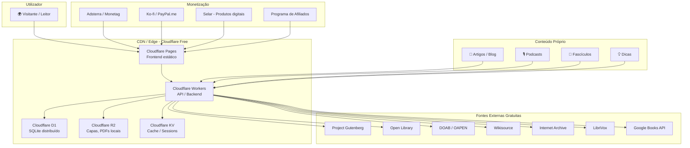
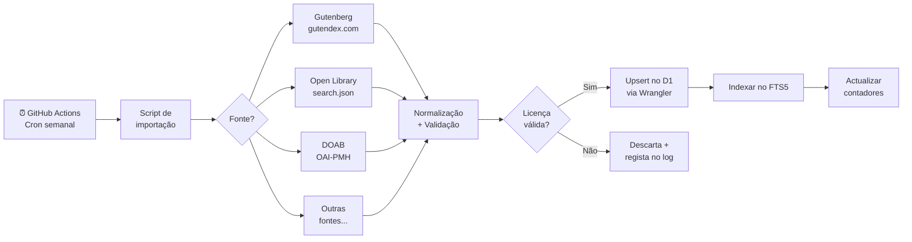

# 🏗️ Plano de Arquitectura — Lino Livre 2.0

> **Missão:** Transformar o Lino Livre no maior acervo digital angolano de livros, cursos, artigos, fascículos, podcasts e dicas — **100% gratuito** em infraestrutura, com caminho claro para monetização e autossustentabilidade.

**Data:** 07/10/2026  
**Estado actual:** MVP funcional (Node.js + Express 5 + SQLite, ~2158 recursos catalogados)  
**Meta:** Superar 10 milhões de itens digitais em múltiplas áreas do conhecimento

---

## Índice

1. [Visão Geral da Arquitectura](#1-visão-geral-da-arquitectura)
2. [Stack Tecnológica 100% Gratuita](#2-stack-tecnológica-100-gratuita)
3. [Modelo de Dados Expandido](#3-modelo-de-dados-expandido)
4. [Módulos de Conteúdo](#4-módulos-de-conteúdo)
5. [Sistema de Importação em Massa](#5-sistema-de-importação-em-massa)
6. [Frontend e Experiência do Utilizador](#6-frontend-e-experiência-do-utilizador)
7. [SEO e Descoberta](#7-seo-e-descoberta)
8. [Estratégia de Monetização](#8-estratégia-de-monetização)
9. [Domínio e Marca](#9-domínio-e-marca)
10. [Roadmap de Implementação](#10-roadmap-de-implementação)
11. [Riscos e Mitigações](#11-riscos-e-mitigações)
12. [Métricas de Sucesso](#12-métricas-de-sucesso)

---

## 1. Visão Geral da Arquitectura



### Princípios Arquitecturais

| # | Princípio | Justificação |
|---|---|---|
| 1 | **Edge-first** | Todo o código corre na edge do Cloudflare — sem servidor central, sem VPS |
| 2 | **Catálogo, não armazém** | O Lino Livre indexa e aponta para fontes legais; só armazena ficheiros de domínio público/CC |
| 3 | **Conteúdo legal obrigatório** | Cada item exige licença verificada; fontes piratas são terminantemente proibidas |
| 4 | **Offline-ready** | PWA com Service Worker para acesso sem internet (importante para Angola) |
| 5 | **Mobile-first** | 80%+ do tráfego africano é móvel — design começa pelo telemóvel |
| 6 | **Multilingue** | Português (base), Inglês, Francês, Kimbundu, Umbundu |
| 7 | **Crescimento modular** | Cada tipo de conteúdo é um módulo independente que pode ser activado/desactivado |

---

## 2. Stack Tecnológica 100% Gratuita

### 2.1 Infraestrutura (custo \$0/mês)

| Componente | Serviço Gratuito | Limites do Free Tier | Para que serve |
|---|---|---|---|
| **Frontend (SSG)** | **Cloudflare Pages** | 500 builds/mês, bandwidth ilimitado, 1 build por vez | Site estático, SPA, blog |
| **Backend / API** | **Cloudflare Workers** | 100.000 requests/dia, 10ms CPU/request | API REST, importadores, lógica |
| **Base de dados** | **Cloudflare D1** | 5 GB storage, 5M rows read/dia, 100K rows write/dia | Catálogo de livros, cursos, artigos |
| **Armazenamento de ficheiros** | **Cloudflare R2** | 10 GB storage, 10M reads/mês, 1M writes/mês, egress grátis | Capas, PDFs de domínio público, áudio |
| **Cache / KV** | **Cloudflare KV** | 100K reads/dia, 1K writes/dia | Cache de API, sessões, contadores |
| **Repositório de código** | **GitHub** | Ilimitado (público) | Código-fonte, CI/CD |
| **CI/CD** | **GitHub Actions** | 2.000 min/mês (repos públicos: ilimitado) | Deploy automático |
| **Analytics** | **Cloudflare Web Analytics** | Gratuito, sem cookies, RGPD-friendly | Métricas de visitantes |
| **Email transacional** | **Resend** | 100 emails/dia (free tier) | Newsletter, alertas |
| **Podcast hosting** | **Spotify for Creators** | Ilimitado, grátis | Hosting + distribuição RSS |
| **Vídeo** | **YouTube** | Ilimitado, grátis | Videoaulas, tutoriais |
| **Imagens / Diagramas** | **Excalidraw / Canva Free** | Grátis | Infográficos para artigos |

### 2.2 Migração do MVP actual

O projecto actual usa `node:sqlite` (SQLite nativo do Node.js) com Express 5. A migração para Cloudflare Workers + D1 requer:

| De (actual) | Para (novo) | Esforço |
|---|---|---|
| `node:sqlite` | Cloudflare D1 (API compatível com SQL) | Médio — reescrever a camada `src/database/index.js` |
| Express 5 routes | Hono (framework leve para Workers) ou itty-router | Médio — mesma lógica, router diferente |
| `public/` estático | Cloudflare Pages (deploy do `public/`) | Baixo — copiar directamente |
| `npm run seed` | Wrangler D1 migrations + seed script | Baixo |
| QR codes SVG (runtime) | Geração no Worker (mesma lib `qrcode`) | Baixo |
| Capas em `public/capas/` | Upload para Cloudflare R2 | Baixo |

> [!TIP]
> **Alternativa zero-reescrita:** Se preferires não migrar agora, podes usar **Render.com** (free tier) para manter o Express tal como está. O trade-off é que o servidor adormece após 15 min de inactividade (30-60s para acordar). Funciona bem para um MVP enquanto cresces.

### 2.3 Estrutura do projecto (pós-migração)

```
lino-livre/
├── public/                    # Cloudflare Pages (frontend)
│   ├── index.html
│   ├── css/
│   ├── js/
│   │   ├── app.js
│   │   ├── i18n.js
│   │   ├── sw.js             # Service Worker (PWA)
│   │   └── reader.js         # Leitor EPUB/PDF inline
│   ├── locales/              # Ficheiros de tradução
│   ├── capas/                # Migrar para R2
│   ├── manifest.json         # PWA manifest
│   └── robots.txt
├── workers/                   # Cloudflare Workers (backend)
│   ├── src/
│   │   ├── index.ts          # Router principal (Hono)
│   │   ├── routes/
│   │   │   ├── livros.ts
│   │   │   ├── cursos.ts
│   │   │   ├── artigos.ts
│   │   │   ├── podcasts.ts
│   │   │   ├── fasciculos.ts
│   │   │   ├── dicas.ts
│   │   │   ├── import.ts
│   │   │   ├── dashboard.ts
│   │   │   ├── comunidade.ts
│   │   │   └── search.ts     # Busca unificada FTS
│   │   ├── services/
│   │   │   ├── gutenberg.ts
│   │   │   ├── openlibrary.ts
│   │   │   ├── doab.ts
│   │   │   ├── wikisource.ts
│   │   │   ├── librivox.ts
│   │   │   └── google-books.ts
│   │   ├── middleware/
│   │   │   ├── cors.ts
│   │   │   ├── cache.ts
│   │   │   └── rateLimit.ts
│   │   └── utils/
│   │       ├── qrcode.ts
│   │       └── pagination.ts
│   ├── migrations/           # D1 SQL migrations
│   └── wrangler.toml         # Configuração Workers
├── content/                   # Conteúdo editorial (Markdown)
│   ├── artigos/
│   ├── dicas/
│   ├── fasciculos/
│   └── paginas/              # Páginas estáticas (sobre, créditos)
├── scripts/                   # Scripts de importação em massa
│   ├── import-gutenberg.ts
│   ├── import-doab.ts
│   └── validate-links.ts
├── .github/
│   └── workflows/
│       ├── deploy.yml        # Deploy Pages + Workers
│       └── import-cron.yml   # Importação semanal automática
└── package.json
```

---

## 3. Modelo de Dados Expandido

### 3.1 Schema SQL (Cloudflare D1)

```sql
-- ╔══════════════════════════════════════════════════════════════╗
-- ║  LINO LIVRE 2.0 — Schema para Cloudflare D1                ║
-- ║  Suporta: Livros, Cursos, Artigos, Fascículos,             ║
-- ║           Podcasts, Dicas, Importação em massa              ║
-- ╚══════════════════════════════════════════════════════════════╝

-- ═══════════════════════════════════════
-- TABELAS CORE
-- ═══════════════════════════════════════

CREATE TABLE categorias (
    id INTEGER PRIMARY KEY AUTOINCREMENT,
    nome TEXT NOT NULL UNIQUE,
    slug TEXT NOT NULL UNIQUE,
    descricao TEXT,
    icone TEXT,                -- Emoji ou classe CSS
    pai_id INTEGER REFERENCES categorias(id) ON DELETE SET NULL,
    ordem INTEGER DEFAULT 0
);

CREATE TABLE autores (
    id INTEGER PRIMARY KEY AUTOINCREMENT,
    nome TEXT NOT NULL,
    slug TEXT NOT NULL UNIQUE,
    bio TEXT,
    foto_url TEXT,
    pais TEXT,                 -- Código ISO 3166 (AO, BR, PT, MZ...)
    wikipedia_url TEXT,
    criado_em DATETIME DEFAULT CURRENT_TIMESTAMP
);

CREATE TABLE fontes (
    id INTEGER PRIMARY KEY AUTOINCREMENT,
    slug TEXT NOT NULL UNIQUE,
    nome TEXT NOT NULL,
    tipo TEXT NOT NULL CHECK (tipo IN ('api','opds','rss','csv','oai-pmh','manual')),
    url_base TEXT,
    ativa INTEGER NOT NULL DEFAULT 1,
    ultima_sync DATETIME
);

CREATE TABLE etiquetas (
    id INTEGER PRIMARY KEY AUTOINCREMENT,
    nome TEXT NOT NULL UNIQUE,
    slug TEXT NOT NULL UNIQUE
);

-- ═══════════════════════════════════════
-- 📚 LIVROS (Módulo principal)
-- ═══════════════════════════════════════

CREATE TABLE livros (
    id INTEGER PRIMARY KEY AUTOINCREMENT,
    titulo TEXT NOT NULL,
    subtitulo TEXT,
    isbn TEXT,
    ano_publicacao INTEGER,
    idioma TEXT DEFAULT 'pt',
    sinopse TEXT,
    capa_url TEXT,
    paginas INTEGER,
    autor_id INTEGER REFERENCES autores(id) ON DELETE SET NULL,
    categoria_id INTEGER REFERENCES categorias(id) ON DELETE SET NULL,
    fonte_id INTEGER REFERENCES fontes(id) ON DELETE SET NULL,
    fonte_id_externo TEXT,
    licenca TEXT NOT NULL CHECK (licenca IN (
        'dominio-publico','cc0','cc-by','cc-by-sa',
        'cc-by-nc','cc-by-nc-sa','cc-by-nd','outro'
    )),
    leituras INTEGER NOT NULL DEFAULT 0,
    downloads INTEGER NOT NULL DEFAULT 0,
    favoritos INTEGER NOT NULL DEFAULT 0,
    destaque INTEGER NOT NULL DEFAULT 0,   -- 1 = aparece na home
    criado_em DATETIME DEFAULT CURRENT_TIMESTAMP,
    atualizado_em DATETIME DEFAULT CURRENT_TIMESTAMP,
    UNIQUE (fonte_id, fonte_id_externo)
);

CREATE TABLE links_livros (
    id INTEGER PRIMARY KEY AUTOINCREMENT,
    livro_id INTEGER NOT NULL REFERENCES livros(id) ON DELETE CASCADE,
    formato TEXT NOT NULL CHECK (formato IN (
        'epub','pdf','txt','html','audiobook','mobi','djvu'
    )),
    url TEXT NOT NULL,
    tamanho_bytes INTEGER,
    link_externo INTEGER NOT NULL DEFAULT 1,
    verificado_em DATETIME,
    UNIQUE (livro_id, formato)
);

CREATE TABLE livros_etiquetas (
    livro_id INTEGER NOT NULL REFERENCES livros(id) ON DELETE CASCADE,
    etiqueta_id INTEGER NOT NULL REFERENCES etiquetas(id) ON DELETE CASCADE,
    PRIMARY KEY (livro_id, etiqueta_id)
);

-- ═══════════════════════════════════════
-- 🎓 CURSOS
-- ═══════════════════════════════════════

CREATE TABLE cursos (
    id INTEGER PRIMARY KEY AUTOINCREMENT,
    titulo TEXT NOT NULL,
    descricao TEXT,
    plataforma TEXT NOT NULL,
    plataforma_url TEXT,       -- URL da homepage da plataforma
    url TEXT NOT NULL UNIQUE,   -- URL directo do curso
    area TEXT NOT NULL,
    nivel TEXT CHECK (nivel IN ('iniciante','intermedio','avancado','todos')),
    idioma TEXT DEFAULT 'pt',
    certificado TEXT CHECK (certificado IN ('gratuito','pago','nenhum')),
    requisitos TEXT,           -- "CPF", "conta gov.br", "nenhum"
    duracao_horas INTEGER,
    instrutor TEXT,
    tipo TEXT DEFAULT 'curso' CHECK (tipo IN (
        'curso','bootcamp','imersao','mooc','livro-texto',
        'simulacao','catalogo','roadmap','tutorial'
    )),
    capa_url TEXT,
    licenca TEXT,
    ativo INTEGER NOT NULL DEFAULT 1,
    verificado_em DATETIME,
    categoria_id INTEGER REFERENCES categorias(id) ON DELETE SET NULL,
    visitas INTEGER NOT NULL DEFAULT 0,
    criado_em DATETIME DEFAULT CURRENT_TIMESTAMP
);

-- ═══════════════════════════════════════
-- 📝 ARTIGOS / BLOG
-- ═══════════════════════════════════════

CREATE TABLE artigos (
    id INTEGER PRIMARY KEY AUTOINCREMENT,
    titulo TEXT NOT NULL,
    slug TEXT NOT NULL UNIQUE,
    resumo TEXT,               -- Max 300 chars para cards e SEO
    conteudo_md TEXT NOT NULL,  -- Markdown completo
    conteudo_html TEXT,         -- HTML pré-renderizado
    capa_url TEXT,
    autor_id INTEGER REFERENCES autores(id) ON DELETE SET NULL,
    categoria_id INTEGER REFERENCES categorias(id) ON DELETE SET NULL,
    status TEXT NOT NULL DEFAULT 'rascunho' CHECK (status IN (
        'rascunho','publicado','arquivado'
    )),
    idioma TEXT DEFAULT 'pt',
    tempo_leitura_min INTEGER,
    visualizacoes INTEGER NOT NULL DEFAULT 0,
    publicado_em DATETIME,
    criado_em DATETIME DEFAULT CURRENT_TIMESTAMP,
    atualizado_em DATETIME DEFAULT CURRENT_TIMESTAMP
);

CREATE TABLE artigos_etiquetas (
    artigo_id INTEGER NOT NULL REFERENCES artigos(id) ON DELETE CASCADE,
    etiqueta_id INTEGER NOT NULL REFERENCES etiquetas(id) ON DELETE CASCADE,
    PRIMARY KEY (artigo_id, etiqueta_id)
);

-- ═══════════════════════════════════════
-- 📄 FASCÍCULOS (séries temáticas)
-- ═══════════════════════════════════════

CREATE TABLE series_fasciculos (
    id INTEGER PRIMARY KEY AUTOINCREMENT,
    titulo TEXT NOT NULL,
    slug TEXT NOT NULL UNIQUE,
    descricao TEXT,
    capa_url TEXT,
    categoria_id INTEGER REFERENCES categorias(id) ON DELETE SET NULL,
    periodicidade TEXT CHECK (periodicidade IN (
        'semanal','quinzenal','mensal','irregular'
    )),
    status TEXT DEFAULT 'ativa' CHECK (status IN ('ativa','completa','pausada')),
    criado_em DATETIME DEFAULT CURRENT_TIMESTAMP
);

CREATE TABLE fasciculos (
    id INTEGER PRIMARY KEY AUTOINCREMENT,
    serie_id INTEGER NOT NULL REFERENCES series_fasciculos(id) ON DELETE CASCADE,
    numero INTEGER NOT NULL,
    titulo TEXT NOT NULL,
    slug TEXT NOT NULL UNIQUE,
    resumo TEXT,
    conteudo_md TEXT NOT NULL,
    conteudo_html TEXT,
    pdf_url TEXT,               -- PDF para download (R2)
    capa_url TEXT,
    autor_id INTEGER REFERENCES autores(id) ON DELETE SET NULL,
    idioma TEXT DEFAULT 'pt',
    publicado_em DATETIME,
    downloads INTEGER NOT NULL DEFAULT 0,
    visualizacoes INTEGER NOT NULL DEFAULT 0,
    criado_em DATETIME DEFAULT CURRENT_TIMESTAMP,
    UNIQUE (serie_id, numero)
);

-- ═══════════════════════════════════════
-- 🎙️ PODCASTS
-- ═══════════════════════════════════════

CREATE TABLE podcasts_shows (
    id INTEGER PRIMARY KEY AUTOINCREMENT,
    titulo TEXT NOT NULL,
    slug TEXT NOT NULL UNIQUE,
    descricao TEXT,
    capa_url TEXT,
    rss_url TEXT,               -- Feed RSS do Spotify for Creators
    spotify_url TEXT,
    apple_url TEXT,
    google_url TEXT,
    idioma TEXT DEFAULT 'pt',
    categoria_id INTEGER REFERENCES categorias(id) ON DELETE SET NULL,
    criado_em DATETIME DEFAULT CURRENT_TIMESTAMP
);

CREATE TABLE podcasts_episodios (
    id INTEGER PRIMARY KEY AUTOINCREMENT,
    show_id INTEGER NOT NULL REFERENCES podcasts_shows(id) ON DELETE CASCADE,
    numero INTEGER,
    titulo TEXT NOT NULL,
    slug TEXT NOT NULL UNIQUE,
    descricao TEXT,
    duracao_segundos INTEGER,
    audio_url TEXT NOT NULL,     -- URL do Spotify for Creators
    transcricao_md TEXT,         -- Transcrição para SEO e acessibilidade
    convidado TEXT,
    publicado_em DATETIME,
    reproducoes INTEGER NOT NULL DEFAULT 0,
    criado_em DATETIME DEFAULT CURRENT_TIMESTAMP
);

-- ═══════════════════════════════════════
-- 💡 DICAS (conteúdo curto)
-- ═══════════════════════════════════════

CREATE TABLE dicas (
    id INTEGER PRIMARY KEY AUTOINCREMENT,
    titulo TEXT NOT NULL,
    slug TEXT NOT NULL UNIQUE,
    conteudo_md TEXT NOT NULL,   -- Máx 1000 palavras
    conteudo_html TEXT,
    categoria_id INTEGER REFERENCES categorias(id) ON DELETE SET NULL,
    tipo TEXT DEFAULT 'dica' CHECK (tipo IN (
        'dica','citacao','curiosidade','tutorial-rapido','ferramenta'
    )),
    fonte_url TEXT,
    autor_id INTEGER REFERENCES autores(id) ON DELETE SET NULL,
    idioma TEXT DEFAULT 'pt',
    visualizacoes INTEGER NOT NULL DEFAULT 0,
    publicado_em DATETIME,
    criado_em DATETIME DEFAULT CURRENT_TIMESTAMP
);

-- ═══════════════════════════════════════
-- 🔄 SISTEMA DE IMPORTAÇÃO
-- ═══════════════════════════════════════

CREATE TABLE import_jobs (
    id INTEGER PRIMARY KEY AUTOINCREMENT,
    fonte_id INTEGER NOT NULL REFERENCES fontes(id),
    query TEXT,
    tipo TEXT DEFAULT 'livros' CHECK (tipo IN (
        'livros','cursos','artigos'
    )),
    status TEXT NOT NULL DEFAULT 'pendente' CHECK (status IN (
        'pendente','em_curso','concluido','erro','cancelado'
    )),
    total INTEGER DEFAULT 0,
    processados INTEGER DEFAULT 0,
    inseridos INTEGER DEFAULT 0,
    duplicados INTEGER DEFAULT 0,
    erros INTEGER DEFAULT 0,
    log_json TEXT,              -- JSON com detalhes dos erros
    criado_em DATETIME DEFAULT CURRENT_TIMESTAMP,
    concluido_em DATETIME
);

-- ═══════════════════════════════════════
-- 📊 CONTADORES E ANALYTICS
-- ═══════════════════════════════════════

CREATE TABLE visitas_diarias (
    data TEXT NOT NULL,          -- 'YYYY-MM-DD'
    tipo TEXT NOT NULL,          -- 'livro', 'curso', 'artigo', etc.
    item_id INTEGER NOT NULL,
    visitas INTEGER NOT NULL DEFAULT 1,
    PRIMARY KEY (data, tipo, item_id)
);

-- ═══════════════════════════════════════
-- 🔍 FULL-TEXT SEARCH (FTS5)
-- ═══════════════════════════════════════

-- Busca unificada de todo o conteúdo
CREATE VIRTUAL TABLE conteudo_fts USING fts5(
    titulo,
    autor_nome,
    descricao,
    tipo,                       -- 'livro', 'curso', 'artigo', 'fasciculo', 'podcast', 'dica'
    item_id UNINDEXED,          -- ID na tabela de origem
    content=''                  -- Contentless — gerir manualmente
);

-- ═══════════════════════════════════════
-- ÍNDICES DE PERFORMANCE
-- ═══════════════════════════════════════

CREATE INDEX idx_livros_categoria ON livros(categoria_id);
CREATE INDEX idx_livros_autor ON livros(autor_id);
CREATE INDEX idx_livros_idioma ON livros(idioma);
CREATE INDEX idx_livros_licenca ON livros(licenca);
CREATE INDEX idx_livros_destaque ON livros(destaque) WHERE destaque = 1;
CREATE INDEX idx_livros_leituras ON livros(leituras DESC);
CREATE INDEX idx_cursos_area ON cursos(area);
CREATE INDEX idx_cursos_nivel ON cursos(nivel);
CREATE INDEX idx_artigos_status ON artigos(status, publicado_em DESC);
CREATE INDEX idx_artigos_slug ON artigos(slug);
CREATE INDEX idx_dicas_tipo ON dicas(tipo);
CREATE INDEX idx_fasciculos_serie ON fasciculos(serie_id, numero);
CREATE INDEX idx_episodios_show ON podcasts_episodios(show_id, publicado_em DESC);
CREATE INDEX idx_visitas_data ON visitas_diarias(data DESC);
```

### 3.2 Estimativa de armazenamento para 10M de itens

| Dado | Tamanho médio/registo | 10M registos | Notas |
|---|---|---|---|
| Metadados (título, autor, sinopse, URLs) | ~500 bytes | ~5 GB | Cabe no D1 free tier (5 GB) |
| Índice FTS5 | ~200 bytes | ~2 GB | Incluído nos 5 GB |
| Capas (thumbnails 200x300, WebP) | ~15 KB | ~150 GB | Excede R2 free (10 GB) — usar URLs externas |
| PDFs/EPUBs rehosteados | Não aplicável | 0 | Usar deep links para fontes externas |

> [!IMPORTANT]
> **Estratégia para 10M de itens:** O Lino Livre armazena apenas **metadados + links**. Os ficheiros ficam nas fontes originais (Gutenberg, Internet Archive, DOAB). Capas usam URLs externas (Open Library, Google Books). Isto permite escalar para milhões sem custo de armazenamento.

> **Quando o D1 free (5 GB) acabar:** A monetização já deve cobrir os \$5/mês do Workers Paid (aumento para 50 GB D1 + limites muito maiores).

---

## 4. Módulos de Conteúdo

### 4.1 📚 Livros (módulo principal)

**Fontes de importação automática (APIs gratuitas):**

| # | Fonte | Acervo estimado | API / Formato | Licença | Prioridade |
|---|---|---|---|---|---|
| 1 | **Project Gutenberg** (via gutendex) | 70.000+ | REST JSON | Domínio público | P0 |
| 2 | **Open Library** / Internet Archive | 20M+ registos (filtrar PD) | REST JSON | Mista — filtrar `ebook_access` | P0 |
| 3 | **DOAB** (Directory of Open Access Books) | 100.000+ | OAI-PMH, REST, CSV | Acesso aberto, metadados CC0 | P0 |
| 4 | **OAPEN** | 30.000+ | OAI-PMH | CC | P1 |
| 5 | **Wikisource PT** | 5.000+ | MediaWiki API | PD / CC BY-SA | P1 |
| 6 | **Standard Ebooks** | 1.000+ | OPDS | CC0 / PD | P1 |
| 7 | **Europeana** | Milhões (filtrar livros) | REST API (chave grátis) | Filtrável por licença | P2 |
| 8 | **HathiTrust** | 17M+ (filtrar full view) | API (chave grátis) | PD (full view only) | P2 |
| 9 | **Google Books** | Enriquecimento | REST (chave grátis) | Capas e sinopses | P1 (enriquecer) |
| 10 | **LibriVox** | 16.000+ audiolivros | REST API | PD | P1 |
| 11 | **StoryWeaver** (Pratham Books) | 10.000+ infantis | Download | CC BY 4.0 | P1 |
| 12 | **African Storybook** | 2.000+ | Download | CC BY | P1 |

**Fontes de curadoria manual (sem API estável):**

| # | Fonte | Foco | Licença |
|---|---|---|---|
| 13 | Domínio Público (MEC Brasil) | Literatura, ciências | PD |
| 14 | Biblioteca Nacional Digital (Portugal) | Obras portuguesas | PD |
| 15 | Brasiliana Mindlin (USP) | Obras raras brasileiras | PD |
| 16 | Memórias de África e do Oriente | Documentos lusófonos africanos | Mista |
| 17 | eduCAPES | Materiais educacionais | Aberta |
| 18 | SciELO Livros | Académicos | Acesso aberto |

**Potencial total estimado:** ~22 milhões de registos importáveis (metadados + links)

### 4.2 🎓 Cursos

**Estrutura no site:**
- Página `/cursos` com filtros por área, nível, idioma, plataforma e certificado
- Cards com: título, plataforma, duração, nível, badge "certificado grátis"
- Aviso claro quando o certificado é pago ou quando requer CPF/conta gov.br

**Fontes já mapeadas (do FONTES-CONTEUDO-GRATUITO.md):**
- 129+ plataformas de cursos
- 178 cursos concretos com link directo
- Guia de TI como fonte principal de tecnologia (RSS 2.0)

**Categorias de cursos:**

| Área | Nº mínimo | Plataformas principais |
|---|---|---|
| 🩺 Saúde | 15 | OpenWHO, NAU, Lúmina, Aprenda Mais |
| 🎨 Artes e Cultura | 10 | Escult, Lúmina |
| 🌱 Agricultura | 10 | Embrapa e-Campo |
| 🗣️ Línguas | 10 | NAU, Duolingo, Khan PT |
| 📐 Matemática e Ciências | 15 | Khan, MIT OCW, CK-12, PhET |
| 🏛️ Humanas | 10 | Lúmina, Khan, ENAP |
| 💼 Gestão | 10 | Sebrae, Fundação Bradesco |
| 💻 Tecnologia (máx 20%) | 20 | Guia de TI, CS50, freeCodeCamp, DIO |
| 🇦🇴 Contexto angolano | 5+ | Cursos de educação cívica, história de Angola |

### 4.3 📝 Artigos / Blog

**Objectivo:** Criar conteúdo original que gere tráfego orgânico (SEO) e posicione o Lino Livre como referência educativa angolana.

**Formato:** Markdown armazenado em D1, renderizado para HTML.

**Tipos de artigos:**

| Tipo | Exemplo | Frequência |
|---|---|---|
| **Resenha de livro** | "5 razões para ler 'O Segredo do Velho' de Pepetela" | 2x/semana |
| **Lista curada** | "10 livros angolanos que todo estudante deve ler" | 1x/semana |
| **Tutorial** | "Como usar o Lino Livre para estudar para os exames" | 1x/mês |
| **Opinião / Editorial** | "A importância da leitura digital em Angola" | 2x/mês |
| **Entrevista** | "Conversa com o autor X sobre o futuro da literatura angolana" | 1x/mês |
| **Especial temático** | "Mês da África: 30 livros, 30 dias" | Sazonal |
| **Guia prático** | "Como converter um PDF para EPUB gratuitamente" | Quando necessário |

**Workflow editorial:**
1. Rascunho em Markdown (ficheiro local ou editor no admin)
2. Revisão (pode ser colaborativa via GitHub PR)
3. Publicação (status = 'publicado', gera slug, indexa no FTS)
4. Partilha automática no canal WhatsApp + redes sociais

### 4.4 📄 Fascículos (séries temáticas)

**Conceito:** Mini-publicações periódicas sobre um tema, como uma revista digital. Cada fascículo pertence a uma série.

**Exemplos de séries:**

| Série | Descrição | Periodicidade |
|---|---|---|
| **"Ler Angola"** | Um autor angolano por edição: bio, obras, contexto histórico | Mensal |
| **"Ciência para Todos"** | Explicações acessíveis de conceitos científicos | Quinzenal |
| **"Histórias de África"** | Contos e lendas de diferentes países africanos | Mensal |
| **"O Estudante Digital"** | Dicas de estudo, produtividade, ferramentas gratuitas | Quinzenal |
| **"Guia do Empreendedor"** | Mini-guias de negócios para o contexto angolano | Mensal |
| **"Dicionário Kimbundu"** | Vocabulário temático Kimbundu-Português por fascículo | Semanal |

**Formato:** Página web (HTML) + PDF para download (gerado e armazenado no R2).

### 4.5 🎙️ Podcasts

**Conceito:** Podcasts educativos e culturais angolanos, hospedados gratuitamente no Spotify for Creators.

**Shows planeados:**

| Show | Formato | Duração | Frequência |
|---|---|---|---|
| **"Lino Conversa"** | Entrevistas com autores, professores, empreendedores angolanos | 30-60 min | Semanal |
| **"Livro da Semana"** | Resenha em áudio de um livro do acervo | 10-15 min | Semanal |
| **"Dica Rápida"** | Dica de estudo, ferramenta ou recurso gratuito | 3-5 min | Diário/3x semana |
| **"Histórias ao Luar"** | Leitura dramatizada de contos africanos (audiolivro) | 15-30 min | Semanal |

**Stack técnico para podcasts (custo \$0):**
- **Gravação:** Audacity (grátis, open source) ou smartphone
- **Edição:** Audacity
- **Hosting:** Spotify for Creators (ilimitado, grátis, RSS automático)
- **Distribuição:** O RSS do Spotify distribui automaticamente para Apple Podcasts, Google Podcasts, Pocket Casts, etc.
- **No site:** Player embed do Spotify + link para RSS feed + transcrição (SEO)

### 4.6 💡 Dicas

**Conceito:** Conteúdo curto e rápido (< 1000 palavras), perfeito para partilhar no WhatsApp e redes sociais.

**Tipos:**

| Tipo | Exemplo |
|---|---|
| **Dica de estudo** | "Técnica Pomodoro: como estudar 25 minutos e reter mais" |
| **Citação inspiradora** | "'Quem lê, viaja sem sair do lugar' — Provérbio angolano" |
| **Curiosidade** | "Sabia que Angola tem mais de 40 línguas nativas?" |
| **Tutorial rápido** | "Como baixar um ebook gratuito do Project Gutenberg" |
| **Ferramenta grátis** | "Canva: crie apresentações profissionais sem pagar nada" |

**Formato no site:** Cards curtos na homepage + página `/dicas` com scroll infinito.

---

## 5. Sistema de Importação em Massa

### 5.1 Arquitectura do pipeline de importação



### 5.2 Estratégia para atingir 10 milhões de registos

| Fase | Fonte | Registos estimados | Acumulado |
|---|---|---|---|
| **Fase 1** (mês 1-2) | Gutenberg (70K) + DOAB (100K) + Wikisource PT (5K) | ~175.000 | 175K |
| **Fase 2** (mês 3-4) | Open Library PD (filtrado) — ~500K títulos livres | ~500.000 | 675K |
| **Fase 3** (mês 5-6) | OAPEN (30K) + Standard Ebooks (1K) + LibriVox (16K) + StoryWeaver (10K) + African Storybook (2K) | ~60.000 | 735K |
| **Fase 4** (mês 7-12) | Europeana livros (filtro licença, ~2M) + HathiTrust PD (~3M) | ~5.000.000 | 5.7M |
| **Fase 5** (ano 2) | Internet Archive full-text PD (~10M) + curadoria contínua | ~5.000.000 | 10.7M |

> [!NOTE]
> **Realismo:** 10M de metadados indexáveis é alcançável com as fontes acima. A Internet Archive/Open Library sozinha tem 20M+ de registos. O filtro de "apenas licença livre" e deduplicação reduzem o número, mas 10M é viável em 18-24 meses com importação automatizada.

### 5.3 Rate limiting e respeito às fontes

```
Cada importador:
├── Rate limit: máx 2 req/segundo (configurável por fonte)
├── Backoff exponencial em erro 429 (1s → 2s → 4s → 8s → pausa 60s)
├── User-Agent: "LinoLivre/2.0 (+https://linolivre.pages.dev; educacional)"
├── Respeito a robots.txt (verificado antes da primeira request)
├── Idempotência: UNIQUE(fonte_id, fonte_id_externo) → ON CONFLICT DO UPDATE
├── Cache local: resposta crua guardada 24h (evita re-fetch)
└── Log completo: import_jobs com total/processados/inseridos/duplicados/erros
```

### 5.4 Enriquecimento de metadados

Para cada livro importado, um segundo passo (assíncrono) enriquece:

1. **Capa:** Google Books API → Open Library Covers API → capa genérica por categoria
2. **Sinopse:** Google Books API → DOAB → sinopse padrão ("Obra de domínio público...")
3. **Categorias:** Mapeamento BISAC/Dewey → categorias do Lino Livre
4. **Idioma:** Detecção automática (já fornecido por Gutenberg/OL)
5. **Etiquetas:** Extracção de palavras-chave do título/sinopse

---

## 6. Frontend e Experiência do Utilizador

### 6.1 Páginas do site

| Página | URL | Descrição |
|---|---|---|
| **Início** | `/` | Hero com busca, destaques, últimas adições, contadores do acervo |
| **Acervo** | `/acervo` | Busca FTS + filtros (categoria, idioma, formato, licença), paginação |
| **Livro** | `/livro/:slug` | Ficha completa: sinopse, autor, capa, botões ler/baixar, livros relacionados |
| **Cursos** | `/cursos` | Directório com filtros (área, nível, plataforma, certificado) |
| **Artigos** | `/blog` | Blog com artigos, filtro por categoria e etiqueta |
| **Artigo** | `/blog/:slug` | Artigo completo com índice lateral, tempo de leitura, partilha |
| **Fascículos** | `/fasciculos` | Séries e edições |
| **Fascículo** | `/fasciculo/:serie/:numero` | Leitura + download PDF |
| **Podcasts** | `/podcasts` | Shows e episódios com player embed |
| **Dicas** | `/dicas` | Feed de dicas curtas |
| **Dashboard** | `/sobre/numeros` | Métricas públicas do acervo |
| **Sobre** | `/sobre` | Missão, equipa, créditos, licenças |
| **Comunidade** | `/comunidade` | Links WhatsApp + QR codes + redes sociais |

### 6.2 PWA (Progressive Web App)

**Por que é essencial para Angola:**
- Muitos utilizadores têm internet instável ou cara
- A PWA permite: instalação no ecrã inicial (sem app store), cache offline, notificações

**Implementação:**

```json
// manifest.json
{
  "name": "Lino Livre",
  "short_name": "Lino Livre",
  "description": "Livros livres, para todos — o maior acervo digital angolano",
  "start_url": "/",
  "display": "standalone",
  "background_color": "#ffffff",
  "theme_color": "#1a7f37",
  "icons": [
    { "src": "/img/icon-192.png", "sizes": "192x192", "type": "image/png" },
    { "src": "/img/icon-512.png", "sizes": "512x512", "type": "image/png" }
  ]
}
```

**Service Worker:** Caching strategy
- **Cache-first** para assets estáticos (CSS, JS, imagens, locales)
- **Network-first** para API calls (livros, busca)
- **Stale-while-revalidate** para capas e thumbnails
- Página offline com busca no cache local (últimos 100 livros consultados)

### 6.3 Leitor online integrado

| Formato | Solução | Custo |
|---|---|---|
| EPUB | **epub.js** (open source) | \$0 |
| PDF | **PDF.js** (Mozilla, open source) | \$0 |
| TXT/HTML | Renderização nativa com estilos do Lino Livre | \$0 |
| Audiobook | Player HTML5 `<audio>` com controles customizados | \$0 |

### 6.4 Internacionalização (i18n)

O sistema actual já suporta 5 idiomas. Expandir para:

| Idioma | Código | Prioridade | Notas |
|---|---|---|---|
| Português | `pt` | Base | Já implementado |
| Inglês | `en` | Alta | Já implementado |
| Francês | `fr` | Alta | Já implementado (lusofonia + Africa francófona) |
| Kimbundu | `kmb` | Média | Língua mais falada em Luanda |
| Umbundu | `umb` | Média | Língua mais falada em Angola |
| Espanhol | `es` | Baixa | Público latino-americano |

---

## 7. SEO e Descoberta

### 7.1 Estratégia de SEO

| Técnica | Implementação |
|---|---|
| **Meta tags dinâmicas** | Título, descrição e OG image por página/livro |
| **Sitemap XML** | Gerado automaticamente com todas as páginas e livros |
| **Schema.org (JSON-LD)** | `Book`, `Course`, `Article`, `Podcast`, `BreadcrumbList` |
| **URLs semânticas** | `/livro/pepetela-o-segredo-do-velho` em vez de `/livro/42` |
| **Canonical URLs** | Evitar conteúdo duplicado entre idiomas |
| **robots.txt** | Permitir indexação total |
| **Velocidade** | Cloudflare edge = ~50ms global, Lighthouse 95+ |

### 7.2 Schema.org para cada módulo

```json
// Exemplo: Livro
{
  "@context": "https://schema.org",
  "@type": "Book",
  "name": "O Segredo do Velho",
  "author": { "@type": "Person", "name": "Pepetela" },
  "inLanguage": "pt",
  "datePublished": "1996",
  "description": "...",
  "image": "https://linolivre.pages.dev/capas/segredo-velho.webp",
  "url": "https://linolivre.pages.dev/livro/segredo-do-velho",
  "isAccessibleForFree": true,
  "license": "https://creativecommons.org/publicdomain/"
}
```

### 7.3 Crescimento orgânico

| Canal | Acção | Frequência |
|---|---|---|
| **Google** | SEO on-page + artigos de blog + sitemap | Contínuo |
| **WhatsApp** | Partilha no canal e comunidade | Diário |
| **Facebook** | Página "Lino Livre" com partilha de artigos e dicas | 3x/semana |
| **Instagram** | Citações, capas de livros, dicas visuais (Canva) | 3x/semana |
| **TikTok** | Dicas em vídeo curto (< 60s), "livro do dia" | 3x/semana |
| **YouTube** | Podcasts em vídeo, tutoriais | Semanal |
| **Twitter/X** | Partilha de artigos e novidades | Diário |

---

## 8. Estratégia de Monetização

### 8.1 Princípio fundamental

> **O acesso ao conteúdo é e será sempre 100% gratuito.** A monetização é feita sobre o tráfego, a comunidade e produtos complementares — nunca sobre o acesso aos livros.

### 8.2 Fontes de receita (por ordem de implementação)

#### Fase 1 — Doações (mês 1, \$0 de investimento)

| Plataforma | Como funciona | Requisitos |
|---|---|---|
| **Ko-fi** | Botão "Apoie o Lino Livre" — doações pontuais ou mensais | Conta PayPal ou Stripe |
| **PayPal.me** | Link directo para doação | Conta PayPal |
| **PIX (Brasil)** | QR code para doadores brasileiros | Conta bancária brasileira (opcional) |

**Implementação:** Botão discreto no rodapé e na página "Sobre". Não intrusivo.

#### Fase 2 — Publicidade (mês 3, quando houver tráfego)

| Rede | CPM médio | Aprovação | Notas |
|---|---|---|---|
| **Adsterra** | \$0.50-\$3.00 | Fácil, aceita Angola | Pop-under, banner, social bar |
| **Monetag** | \$0.30-\$2.00 | Fácil | Smart-links, push notifications |
| **Google AdSense** | \$1.00-\$5.00 | Mais exigente, requer domínio próprio | Aplicar quando tiver domínio |
| **Media.net** | \$0.50-\$3.00 | Média | Contextual, bom para conteúdo educativo |

**Política de anúncios:**
- Máximo 2 posições de anúncio por página (topo e rodapé)
- Nunca pop-ups que bloqueiem o conteúdo
- Sem anúncios nas páginas de leitura (para não interromper)
- Sem anúncios na página de livro infantil

**Receita estimada (conservadora):**

| Visitantes/mês | CPM médio | Receita/mês |
|---|---|---|
| 10.000 | \$1.00 | \$10 |
| 50.000 | \$1.00 | \$50 |
| 100.000 | \$1.50 | \$150 |
| 500.000 | \$2.00 | \$1.000 |

#### Fase 3 — Produtos digitais próprios (mês 6)

| Produto | Preço sugerido | Plataforma de venda |
|---|---|---|
| **E-book compilado** "100 Livros Angolanos Essenciais" (guia com sinopses e links) | \$2-5 | Selar, Payhip |
| **Fascículo premium** (edição especial com conteúdo extra) | \$1-3 | Selar |
| **Kit de estudo** (resumos + flashcards + calendário) | \$3-5 | Selar |
| **Curso em vídeo** "Como estudar online gratuitamente" | \$5-10 | Hotmart, Selar |

#### Fase 4 — Afiliados (mês 6+)

| Programa | Comissão | Como integrar |
|---|---|---|
| **Selar** (produtos digitais africanos) | 10-50% | Links afiliados em resenhas |
| **Amazon KDP** (livros em português) | 4-10% | "Compre a edição física" |
| **Hotmart** (cursos em português) | 10-80% | Recomendação de cursos pagos complementares |
| **Hostinger / Namecheap** | \$50-100/venda | Tutoriais "como criar o seu site" |

#### Fase 5 — Patrocínios e parcerias (ano 2+)

| Tipo | Exemplo | Receita |
|---|---|---|
| **Patrocínio de série** | "Série 'Ler Angola' patrocinada por [Empresa]" | \$50-500/mês |
| **Parceria institucional** | Universidades angolanas, ONGs educativas | Financiamento + conteúdo |
| **Eventos** | Workshops online "Feira do Livro Digital Angolano" | Inscrições + patrocínio |

### 8.3 Projecção financeira

| Marco | Tráfego | Receita/mês | O que fazer |
|---|---|---|---|
| **Mês 1-3** | 1K-5K visitas | \$0-10 (doações) | Focar no conteúdo e SEO |
| **Mês 4-6** | 5K-20K visitas | \$20-80 (ads + doações) | Comprar domínio (.ao ou .com) |
| **Mês 7-12** | 20K-100K visitas | \$100-500 (ads + produtos) | Servidor pago se necessário |
| **Ano 2** | 100K-500K visitas | \$500-2000 | Equipa editorial, conteúdo premium |

---

## 9. Domínio e Marca

### 9.1 Fases do domínio

| Fase | Domínio | Custo | Quando |
|---|---|---|---|
| **Agora** | `linolivre.pages.dev` | \$0 | Já disponível no Cloudflare Pages |
| **Alternativa grátis** | `linolivre.is-a.dev` | \$0 | Via GitHub (aprovação em 1-3 dias) |
| **Primeiro upgrade** | `linolivre.com` | ~\$10/ano | Quando a receita cobrir |
| **Angolano** | `linolivre.co.ao` | ~\$25/ano (via DNS.ao) | Para credibilidade local |
| **Ideal final** | `linolivre.ao` | Mais caro | Quando for uma marca estabelecida |

### 9.2 Identidade visual

| Elemento | Especificação |
|---|---|
| **Nome** | Lino Livre |
| **Slogan** | "Livros livres, para todos." |
| **Cores** | Verde (#1a7f37) + Branco + Preto — cores da bandeira angolana + legibilidade |
| **Tipografia** | Inter (UI) + Merriweather (leitura) — ambas no Google Fonts (grátis) |
| **Logo** | Livro aberto estilizado com as cores angolanas — criar no Canva ou Figma (grátis) |
| **Favicon** | SVG do logo, 32x32 e 192x192 |

---

## 10. Roadmap de Implementação

### Fase 0 — Preparação (Semana 1)

- [ ] Criar conta Cloudflare (grátis)
- [ ] Criar projecto Cloudflare Pages (conectar ao GitHub)
- [ ] Criar database D1 (`lino-livre-db`)
- [ ] Criar bucket R2 (`lino-livre-assets`)
- [ ] Configurar `wrangler.toml`
- [ ] Registar subdomínio `linolivre.is-a.dev` (opcional)
- [ ] Criar contas: Ko-fi, Spotify for Creators, Canva

### Fase 1 — Migração do MVP (Semanas 2-3)

- [ ] Migrar schema SQL para D1 migrations
- [ ] Reescrever `src/database/index.js` para D1 bindings
- [ ] Migrar Express routes para Hono (Workers)
- [ ] Deploy do `public/` no Cloudflare Pages
- [ ] Upload de capas para R2
- [ ] Testar: CRUD, FTS5, QR codes, i18n
- [ ] Migrar seed data para D1

### Fase 2 — Importação Inicial (Semanas 4-6)

- [ ] Implementar importador Gutenberg (~70K livros)
- [ ] Implementar importador Open Library (filtro PD, ~500K)
- [ ] Implementar importador DOAB (~100K)
- [ ] Configurar GitHub Actions para importação semanal
- [ ] Implementar enriquecimento de capas (Google Books API)
- [ ] **Meta:** 500K+ livros no acervo

### Fase 3 — Conteúdo Editorial (Semanas 7-10)

- [ ] Implementar módulo de artigos (CRUD + Markdown → HTML)
- [ ] Implementar módulo de dicas
- [ ] Escrever 10 artigos inaugurais
- [ ] Escrever 20 dicas inaugurais
- [ ] Implementar módulo de fascículos
- [ ] Criar primeira série: "Ler Angola" (3 fascículos)
- [ ] Configurar SEO (sitemap, schema.org, meta tags)

### Fase 4 — Podcasts (Semanas 11-13)

- [ ] Criar conta Spotify for Creators
- [ ] Gravar e publicar 3 episódios piloto do "Lino Conversa"
- [ ] Implementar página `/podcasts` com embed Spotify
- [ ] Submeter RSS para Apple Podcasts e Google Podcasts
- [ ] Começar série "Livro da Semana"

### Fase 5 — PWA + Offline (Semanas 14-15)

- [ ] Implementar Service Worker com cache strategies
- [ ] Criar `manifest.json`
- [ ] Implementar leitor EPUB/PDF integrado (epub.js + PDF.js)
- [ ] Testar em dispositivos móveis angolanos (Android low-end)
- [ ] Optimizar para conexões lentas (lazy load, WebP, compression)

### Fase 6 — Monetização (Semanas 16-18)

- [ ] Adicionar botão Ko-fi no rodapé e página "Sobre"
- [ ] Implementar posições de anúncio (Adsterra ou Monetag)
- [ ] Criar página de "Apoie o Lino Livre" com todas as formas de contribuir
- [ ] Criar primeiro produto digital (e-book guia)
- [ ] Configurar links de afiliado

### Fase 7 — Escala (Mês 6-12)

- [ ] Importar fontes adicionais (Europeana, HathiTrust)
- [ ] Atingir 5M+ de livros no acervo
- [ ] Comprar domínio `.com` ou `.co.ao` com receita gerada
- [ ] Expandir equipa editorial (voluntários ou pagos)
- [ ] Implementar sistema de favoritos (localStorage, sem login)
- [ ] Adicionar línguas angolanas (Kimbundu, Umbundu)

### Fase 8 — Consolidação (Ano 2)

- [ ] Atingir 10M+ de livros
- [ ] Migrar para Workers Paid (\$5/mês) se necessário
- [ ] Implementar sistema de contas (opcional, para favoritos sincronizados)
- [ ] Parcerias com universidades angolanas
- [ ] Eventos online (feiras, workshops)
- [ ] App nativa (TWA — Trusted Web Activity, encapsula a PWA para Play Store)

---

## 11. Riscos e Mitigações

| # | Risco | Probabilidade | Impacto | Mitigação |
|---|---|---|---|---|
| 1 | **D1 atinge 5 GB** (10M registos) | Alta | Alto | Monetização cobre \$5/mês para upgrade; ou particionar em múltiplas D1 databases |
| 2 | **100K req/dia insuficientes** | Média | Alto | Cache agressivo via KV/Pages; upgrade a \$5/mês quando monetizar |
| 3 | **APIs externas mudam/caem** | Média | Médio | Múltiplas fontes por dado; cache de 24h; fallback graceful |
| 4 | **Conteúdo com licença errada** | Baixa | Alto | Validação obrigatória no import; auditoria trimestral; canal de denúncia |
| 5 | **Bloqueio de anúncios (ad-blockers)** | Alta | Médio | Diversificar receita (doações, produtos, afiliados) |
| 6 | **Internet instável em Angola** | Alta | Médio | PWA offline-first, compressão agressiva, imagens WebP small |
| 7 | **Cloudflare muda free tier** | Baixa | Alto | Código portável (Hono corre em Deno, Bun, Node.js); export D1 → SQLite local |
| 8 | **Violação de direitos autorais** | Baixa | Muito alto | Lista negra de fontes; licença obrigatória; termos de uso; resposta rápida a takedowns |
| 9 | **Falta de conteúdo angolano** | Média | Médio | Parcerias com autores locais; digitalização de obras PD angolanas; conteúdo editorial próprio |
| 10 | **Spam/abuso na comunidade WhatsApp** | Média | Baixo | Moderação activa; aprovação de membros; regras claras |

---

## 12. Métricas de Sucesso

### KPIs por fase

| Fase | Métrica | Meta |
|---|---|---|
| **MVP** (mês 1-2) | Livros no acervo | 500.000+ |
| **Crescimento** (mês 3-6) | Visitantes únicos/mês | 10.000+ |
| **Conteúdo** (mês 3-6) | Artigos + dicas publicados | 50+ |
| **Podcast** (mês 4+) | Episódios publicados | 20+ |
| **Monetização** (mês 4-6) | Primeira receita (\$) | > \$0 |
| **Escala** (mês 6-12) | Livros no acervo | 5.000.000+ |
| **Domínio** (mês 6) | Domínio próprio comprado | ✅ |
| **Comunidade** (mês 6) | Membros WhatsApp | 500+ |
| **Autossustentabilidade** (ano 2) | Receita mensal | ≥ \$50 (cobre todos os custos) |
| **Recorde** (ano 2) | Livros no acervo | 10.000.000+ |

### Dashboard público

A página `/sobre/numeros` mostra em tempo real:

```
📚 12.847.392 livros catalogados
🎓 1.247 cursos gratuitos
📝 89 artigos publicados
📄 24 fascículos (6 séries)
🎙️ 52 episódios de podcast
💡 203 dicas
🌍 5 idiomas
👥 2.847 membros na comunidade
📖 847.293 leituras totais
```

---

## Resumo Executivo

| Pergunta | Resposta |
|---|---|
| **Quanto custa?** | \$0/mês (100% free tier Cloudflare + GitHub + Spotify) |
| **Quando começa a gerar receita?** | Mês 3-4 (doações + anúncios) |
| **Quando compra o domínio?** | Mês 6 (com receita própria, ~\$10-25/ano) |
| **Quando atinge 10M de livros?** | 18-24 meses (importação automatizada) |
| **Que conteúdo oferece?** | Livros, cursos, artigos, fascículos, podcasts, dicas |
| **Onde ficam os ficheiros?** | Nas fontes originais (Gutenberg, Internet Archive, DOAB...). O Lino Livre indexa e liga. |
| **É legal?** | Sim. Só conteúdo de domínio público, CC ou acesso aberto. Licença obrigatória por item. |
| **Funciona offline?** | Sim. PWA com Service Worker para acesso sem internet. |
| **Funciona no telemóvel?** | Sim. Mobile-first, optimizado para Android low-end e conexões lentas. |

> [!CAUTION]
> **Fontes terminantemente proibidas:** Z-Library, Library Genesis, Sci-Hub, Anna's Archive, e qualquer fonte que distribua conteúdo protegido sem autorização. A legalidade é o alicerce do projecto.

---

*Lino Livre — Livros livres, para todos. 🇦🇴*
