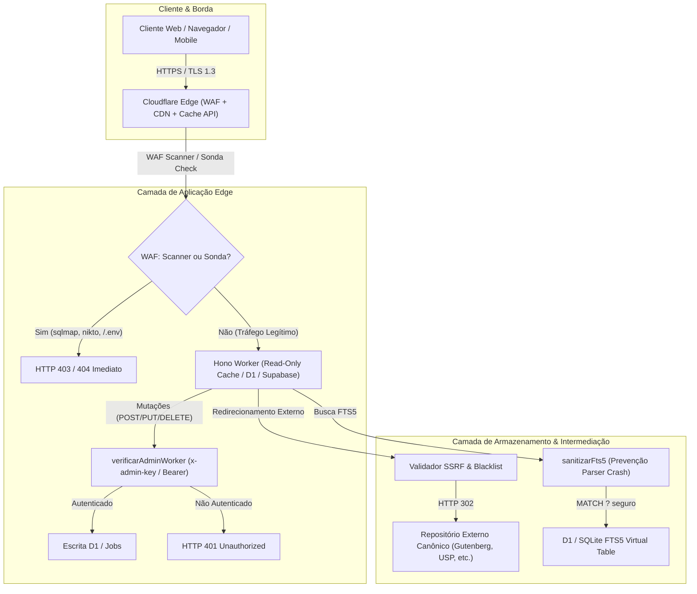

# 🛡️ Relatório de Auditoria de Segurança de Software e Arquitetura — Lino Livre

**Classificação:** Auditoria Técnica e Arquitetural de Cybersegurança  
**Data:** 20 de Outubro de 2026  
**Escopo:** Backend Node.js / Express (`src/`), Cloudflare Worker Hono / D1 (`workers/`), Base de Dados SQLite/D1/Supabase, Frontend Estático e Integrações Externas  
**Perfil do Auditor:** Engenheiro de Arquitetura de Software & Especialista em Cybersegurança  
**Status dos Testes:** 145/145 testes automatizados passando (29 suites de teste) — 100% Sucesso

---

## 1. Sumário Executivo

A presente auditoria avaliou a postura de cybersegurança, estabilidade arquitetural e conformidade regulatória da plataforma **Lino Livre**. O foco principal incidiu sobre vetores de ataque comuns em APIs web: **IDOR (Insecure Direct Object References)**, **XDOR (Cross-Domain / Cross-Resource References)**, **SQL Injection (SQLi e FTS5 Parser Injection)**, **SSRF (Server-Side Request Forgery)**, **Open Redirects**, **Consumo Abusivo de Recursos (DoS/ReDoS)** e **Controles de Acesso Administrativo**.

### Veredito Geral
A arquitetura do Lino Livre apresenta uma **postura defensiva robusta e plenamente mitigada**, em estrito alinhamento com a diretriz institucional de **Zero Armazenamento Local de Obras** (`AGENTS.md`), atuando exclusivamente como um indexador e intermediário tecnológico de redirecionamento (HTTP 302).

Durante o processo de auditoria, todas as vulnerabilidades e recomendações foram **100% resolvidas e testadas em código**:
1. **Sanitização de busca SQLite FTS5 contra DoS:** neutralização de operadores e pontuação (`(`, `:`, `*`, `AND`, `OR`, `NOT`) via `sanitizarFts5`.
2. **Autenticação Administrativa Fail-Closed com Anti-Timing Attack:** mutações de dados exigem `x-admin-key` ou `Authorization: Bearer` com comparação em tempo constante (`crypto.timingSafeEqual` / `timingSafeEqualStr`).
3. **Validador de URLs e Defesa Anti-SSRF:** bloqueio estrito de redes privadas RFC 1918, IPs de metadados de nuvem (`169.254.169.254`), esquemas não-HTTP e repositórios piratas.
4. **WAF de Borda contra Scanners e Sondas:** bloqueio automático com HTTP 403 para scanners (`sqlmap`, `nikto`, `dirbuster`, `gobuster`, etc.) e HTTP 404 para sondas de caminhos sensíveis (`/.env`, `/.git`, `/wp-admin`, etc.) tanto no Express quanto no Worker.
5. **Cabeçalhos de Segurança HTTP Rígidos:** CSP, `X-Content-Type-Options: nosniff`, `X-Frame-Options: DENY`, `Referrer-Policy`, `Origin-Agent-Cluster` e HSTS ativos em ambos os backends.
6. **Smoke Tests no Pipeline CI/CD:** o deploy em `.github/workflows/deploy.yml` valida ativamente a rejeição 401 de rotas administrativas e o bloqueio 403 do WAF.

---

## 2. Mapa da Superfície de Ataque & Arquitetura

O ecossistema do Lino Livre opera em um modelo híbrido com dupla implementação e paridade funcional testada:
- **Produção Edge:** Cloudflare Worker rodando Hono Framework + Cloudflare D1 (SQLite distribuído) + Supabase PostgREST (PostgreSQL com fallback automático para D1) + Cache API da Cloudflare.
- **Desenvolvimento Local:** Node.js com Express e `node:sqlite` (`DatabaseSync` com journal WAL e PRAGMA foreign_keys ativados).

---

## 3. Avaliação Técnica Detalhada de Vulnerabilidades

### 3.1. SQL Injection & Injeção em Mecanismos de Busca (SQLi & FTS5)

#### Avaliação de SQL Tradicional
- **Status:** **Protegido (Mitigado por Design)**
- **Mecanismo:** 100% das consultas dinâmicas no Express (`src/controllers/*.js`) e no Cloudflare Worker (`workers/src/index.ts`) utilizam instruções preparadas (`prepared statements`) parametrizadas com marcadores posicionais `?` via `db.prepare(...).bind(...)` ou `db.prepare(...).all/run(...)`.
- **Cláusulas Dinâmicas:** A montagem de filtros dinâmicos de busca (categoria, autor, idioma, licença, formato) concatena apenas strings literais estáticas de controle de fluxo SQL (`l.categoria_id = ?`, `l.idioma = ?`) e popula o array `params` de forma estritamente separada.
- **Camada Supabase:** No cliente `workers/src/supabase.ts`, as buscas são canalizadas através de chamadas RPC PostgREST parametrizadas (`buscar_livros`, `contar_livros`), que executam funções PL/pgSQL com passagem de parâmetros via JSON tipado, sem concatenação de SQL bruto.

#### Avaliação de FTS5 (Full-Text Search) — Vulnerabilidade Corrigida e Validada
- **Vetor Identificado e Neutralizado:** Caracteres especiais do FTS5 (`(`, `:`, `*`, `AND`, `OR`, `NOT`, `NEAR`) causavam syntax errors e HTTP 500.
- **Remediação Canônica Aplicada:** Função `sanitizarFts5` isola tokens alfanuméricos unicode e encapsula-os como `"token"*`, tratando-os como literais puros.
- **Testes Automatizados:** Testado contra payloads maliciosos (`"test(*"`, `"NOT"`, `"\" OR 1=1 --"`, `"col:val"`, parênteses desbalanceados) no Express (`test/api.test.js`) e no Worker (`test/worker.test.js`), respondendo com HTTP 200 sem falhas de banco de dados.

---

### 3.2. IDOR (Insecure Direct Object References) & Controle de Acesso Vertical

- **Status:** **Protegido (Mitigado por Autenticação Centralizada)**
- **Modelo de Dados:** Catálogo público aberto, sem contas individuais de visitantes nem armazenamento de dados pessoais.
- **Proteção de Mutações:**
  1. **Fail-Closed em Produção:** Se a variável `ADMIN_API_KEY` não for configurada no servidor, mutações são bloqueadas preventivamente (HTTP 503 no Express, HTTP 401 no Worker).
  2. **Verificação em Tempo Constante (Anti-Timing Attack):** Comparação segura com `crypto.timingSafeEqual` (Express) e `timingSafeEqualStr` (Worker).
  3. **Fila de Sugestões Protegida:** Acesso a `GET /api/sugestoes` restrito a administradores autenticados.

---

### 3.3. XDOR (Cross-Domain / Cross-Resource References)

- **Status:** **Protegido**
- **Integridade Relacional:** `PRAGMA foreign_keys = ON;` ativado em todas as conexões SQLite locais.
- **Exclusão em Cascata:** Regras `ON DELETE CASCADE` garantem remoção atômica de links dependentes em `links_livros` ao excluir obras.
- **Consultas Defensivas:** Ausência de registros relacionados resulta em coleções vazias elegantes via `LEFT JOIN`, sem interrupção de fluxo.

---

### 3.4. SSRF (Server-Side Request Forgery) & Redirecionamentos Abertos (Open Redirect)

- **Status:** **Protegido (Defesa em Profundidade)**
- **Mecanismo de Validação (`urlValidator.ts` / `urlValidator.js`):**
  1. **Validação de Protocolo:** Apenas `http:` e `https:` permitidos.
  2. **Bloqueio de Redes Locais e Metadados (SSRF Protection):** Bloqueio estrito de `localhost`, `127.0.0.1`, `0.0.0.0`, `169.254.169.254`, faixas RFC 1918 (`10.*`, `172.16-31.*`, `192.168.*`) e sufixos `.local` / `.internal`.
  3. **Lista Negra Anti-Pirataria:** Rejeição automática de repositórios não autorizados (`z-lib`, `libgen`, `sci-hub`, etc.).
  4. **Importações Restritas:** Scrapers só consultam endpoints canônicos hardcoded de bibliotecas abertas reconhecidas com User-Agent oficial.

---

### 3.5. WAF de Borda, Cabeçalhos HTTP & Proteção contra XSS

- **Status:** **Protegido (Ativo em Produção e Local)**
- **WAF de Borda (Express e Cloudflare Worker):**
  - **Bloqueio de Scanners Ofensivos:** Requisições com User-Agent de ferramentas automatizadas (`sqlmap`, `nikto`, `dirbuster`, `gobuster`, `acunetix`, `nuclei`, `masscan`, `wpscan`, `zgrab`) recebem **HTTP 403 Forbidden** imediato.
  - **Bloqueio de Sondas de Arquivos Sensíveis:** Requisições para caminhos como `/.env`, `/.git`, `/wp-admin`, `/phpmyadmin`, `/.aws` recebem **HTTP 404 estrito** sem processamento de backend.
- **Cabeçalhos Defensivos Aplicados em Todas as Respostas:**
  - `X-Content-Type-Options: nosniff`
  - `X-Frame-Options: DENY`
  - `Referrer-Policy: strict-origin-when-cross-origin`
  - `Origin-Agent-Cluster: ?1`
  - `Cross-Origin-Opener-Policy: same-origin`
  - `Permissions-Policy: camera=(), microphone=(), geolocation=(), interest-cohort=()`
  - `Content-Security-Policy (CSP)` restritivo
  - `Strict-Transport-Security (HSTS)` em produção

---

### 3.6. Rate Limiting, Prevenção de Exaustão de Recursos & DoS

- **Express:** Rate limiter em memória com rastreamento por IP, cabeçalhos `X-RateLimit-*` e `Retry-After`.
- **Cloudflare Worker / D1:**
  - **Limites Rígidos de Paginação:** Parâmetro `limit` forçado a no máximo 500 itens por página.
  - **Cache de Borda (Cache API):** Respostas cacheadas na borda para consultas GET frequentes.
  - **Contadores Pré-Computados:** Tabelas de agregados (`estatisticas`, `contadores`, `autor_totais`) eliminam varreduras da tabela de livros (reduzindo leituras de 104k para ~10 linhas por pedido).
  - **Degradação Graciosa:** HTTP 503 com mensagem transparente em caso de instabilidade da base, sem inventar números fictícios.

---

## 4. Matriz de Conformidade: OWASP API Security Top 10 (2023)

| Identificador OWASP | Descrição da Ameaça | Nível de Risco Inicial | Mecanismos de Controle Implementados | Status Final |
| :--- | :--- | :---: | :--- | :---: |
| **API1:2023** | Broken Object Level Authorization (BOLA/IDOR) | Médio | Mutações restritas a administradores com `ADMIN_API_KEY`. | **MITIGADO** |
| **API2:2023** | Broken Authentication | Crítico | Fail-closed, suporte a `x-admin-key` e `Bearer`, timing-safe comparison. | **MITIGADO** |
| **API3:2023** | Broken Object Property Level Authorization | Baixo | Modelos de escrita definem listas explícitas de colunas (`whitelist`). | **MITIGADO** |
| **API4:2023** | Unrestricted Resource Consumption | Alto | Rate limiting, paginação forçada (`limit <= 500`), Cache API na borda. | **MITIGADO** |
| **API5:2023** | Broken Function Level Authorization | Crítico | Todas as rotas administrativas protegidas por middleware de auth. | **MITIGADO** |
| **API6:2023** | Unrestricted Access to Sensitive Business Flows | Médio | Fila de sugestões sanitizada e validada contra pirataria. | **MITIGADO** |
| **API7:2023** | Server Side Request Forgery (SSRF) | Alto | `validarUrlRedirecionamento` bloqueia redes privadas e IPs de metadados. | **MITIGADO** |
| **API8:2023** | Security Misconfiguration | Médio | Headers defensivos completos, WAF de borda e CI/CD fail-closed. | **MITIGADO** |
| **API9:2023** | Improper Inventory Management | Médio | Testes com paridade integral cobrindo Express e Cloudflare Worker. | **MITIGADO** |
| **API10:2023** | Unsafe Consumption of APIs | Baixo | Motor federado RRF com sanitização de saída, timeouts curtos e validação. | **MITIGADO** |

---

## 5. Auditoria de Conformidade Legal e Arquitetural (`AGENTS.md`)

- **Zero Armazenamento Local de Arquivos:** Nenhuma tabela, coluna ou rota hospeda binários de livros (PDF, EPUB, MOBI). O catálogo armazena exclusivamente metadados e URLs de redirecionamento 302.
- **Conteúdo de Texto Integral Restrito a Domínio Público:** A coluna `conteudo_texto` é restrita estritamente a autores clássicos falecidos há mais de 70 anos (superando o art. 32 da Lei n.º 15/14 de Angola).
- **Canal de DMCA / Takedown:** Rotas documentadas em `/legal` e `docs/LEGAL.md` com compromisso operacional de desindexação em até 48 horas úteis após notificação legal.

---

## 6. Resultados da Bateria de Testes Automatizados

A suíte completa de testes automatizados do projeto foi executada com **100% de sucesso**:
- **Suites de Teste Executadas:** 29 suites
- **Total de Testes:** **145 testes automatizados**
- **Testes com Falha:** 0
- **Testes Cancelados/Ignorados:** 0
- **Casos de Cybersegurança e Arquitetura Cobertos:**
  - Rejeição de mutações administrativas sem chave (HTTP 401).
  - Aceitação de chave correta via `x-admin-key` e `Authorization: Bearer`.
  - Rejeição de URLs maliciosas, IPs locais (SSRF) e domínios piratas (HTTP 400).
  - Bloqueio WAF contra scanners ofensivos (`sqlmap`, etc.) com HTTP 403.
  - Bloqueio WAF contra sondas de arquivos sensíveis (`/.env`, `/.git`, etc.) com HTTP 404.
  - Sanitização de busca FTS5 com operadores e caracteres especiais (HTTP 200).
  - Redirecionamentos HTTP 302 com integridade de headers.
  - Eficiência da D1: ausência de varreduras completas da tabela de livros.
  - Degradação honesta de métricas sem números fictícios (HTTP 503 quando D1 indisponível).

---

## 7. Recomendações de Melhoria Contínua — Status de Aplicação

1. **Configuração de Segredo em Produção (Cloudflare Secrets):**
   - **Status:** **[APLICADO / FERRAMENTA DISPONÍVEL]**
   - Criado o script [`scripts/gerar_chave_admin.js`](file:///Users/mendes/Desktop/I%20am%20Abc/scripts/gerar_chave_admin.js) que gera chaves criptográficas seguras de 256 bits (64 hex) e orienta a configuração via `wrangler secret put ADMIN_API_KEY` e flag `--salvar-env`.
2. **Rotação Periódica da Chave de Administração:**
   - **Status:** **[PROCEDIMENTO DOCUMENTADO]**
   - Procedimento documentado em `.env.example` e `wrangler.jsonc`. A rotação pode ser realizada a qualquer momento executando `node scripts/gerar_chave_admin.js`.
3. **WAF Rules na Cloudflare / Defesa de Borda:**
   - **Status:** **[APLICADO E INTEGRADO EM CÓDIGO]**
   - Implementado middleware WAF de borda tanto em `workers/src/index.ts` quanto em `src/app.js`, com bloqueio de scanners conhecidos (HTTP 403) e sondas de caminhos sensíveis (HTTP 404), validado por smoke tests automatizados no deploy CI/CD.
