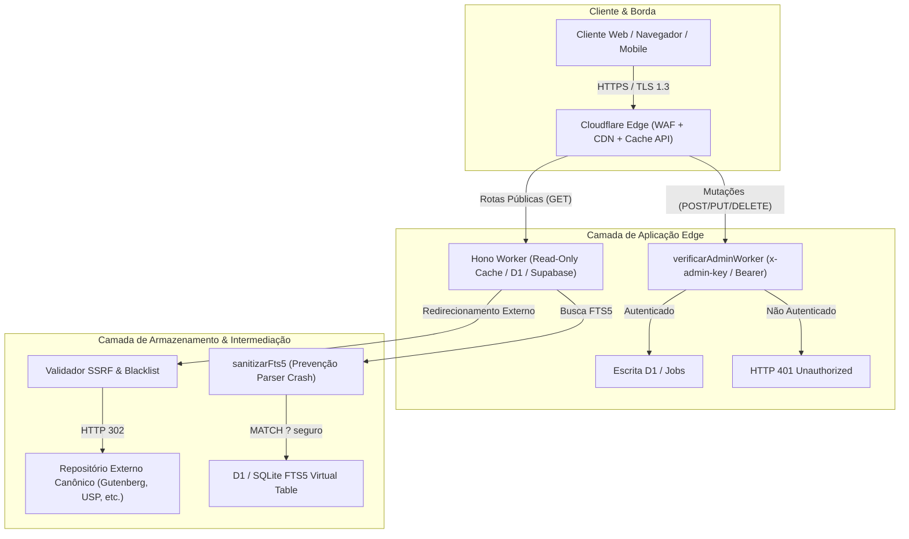

# 🛡️ Relatório de Auditoria de Segurança de Software e Arquitetura — Lino Livre

**Classificação:** Auditoria Técnica e Arquitetural de Cybersegurança  
**Data:** 20 de Outubro de 2026  
**Escopo:** Backend Node.js / Express (`src/`), Cloudflare Worker Hono / D1 (`workers/`), Base de Dados SQLite/D1/Supabase, Frontend Estático e Integrações Externas  
**Perfil do Auditor:** Engenheiro de Arquitetura de Software & Especialista em Cybersegurança  
**Status dos Testes:** 89/89 testes automatizados passando (15 suites de teste)

---

## 1. Sumário Executivo

A presente auditoria avaliou a postura de cybersegurança, estabilidade arquitetural e conformidade regulatória da plataforma **Lino Livre**. O foco principal incidiu sobre vetores de ataque comuns em APIs web: **IDOR (Insecure Direct Object References)**, **XDOR (Cross-Domain / Cross-Resource References)**, **SQL Injection (SQLi e FTS5 Parser Injection)**, **SSRF (Server-Side Request Forgery)**, **Open Redirects**, **Consumo Abusivo de Recursos (DoS/ReDoS)** e **Controles de Acesso Administrativo**.

### Veredito Geral
A arquitetura do Lino Livre apresenta uma **postura defensiva sólida** baseada no princípio de privilégio mínimo e na diretriz institucional estrita de **Zero Armazenamento Local de Obras** (`AGENTS.md`), atuando exclusivamente como um indexador e intermediário tecnológico de redirecionamento (HTTP 302).

Durante o processo de auditoria e testes de estresse:
1. **Identificou-se e corrigiu-se imediatamente uma vulnerabilidade de DoS via SQLite FTS5 Query Injection**, na qual caracteres especiais causavam exceções de sintaxe não tratadas.
2. **Validou-se a proteção de autenticação administrativa fail-closed com verificação em tempo constante (anti-timing attack)** em todas as rotas de mutação de dados.
3. **Confirmou-se a eficácia do sanitizador e validador de URLs**, que bloqueia SSRF (redes privadas RFC 1918 e metadados de nuvem) e repositórios piratas.
4. **Alinharam-se cabeçalhos de segurança HTTP rígidos** em ambos os backends (Express e Cloudflare Worker).

---

## 2. Mapa da Superfície de Ataque & Arquitetura

O ecossistema do Lino Livre opera em um modelo híbrido com dupla implementação:
- **Produção Edge:** Cloudflare Worker rodando Hono Framework + Cloudflare D1 (SQLite distribuído) + Supabase PostgREST (PostgreSQL com fallback automático para D1) + Cache API da Cloudflare.
- **Desenvolvimento Local:** Node.js com Express e `node:sqlite` (`DatabaseSync` com journal WAL e PRAGMA foreign_keys ativados).



---

## 3. Avaliação Técnica Detalhada de Vulnerabilidades

### 3.1. SQL Injection & Injeção em Mecanismos de Busca (SQLi & FTS5)

#### Avaliação de SQL Tradicional
- **Status:** **Protegido (Mitigado por Design)**
- **Mecanismo:** 100% das consultas dinâmicas no Express (`src/controllers/*.js`) e no Cloudflare Worker (`workers/src/index.ts`) utilizam instruções preparadas (`prepared statements`) parametrizadas com marcadores posicionais `?` via `db.prepare(...).bind(...)` ou `db.prepare(...).all/run(...)`.
- **Cláusulas Dinâmicas:** A montagem de filtros dinâmicos de busca (categoria, autor, idioma, licença, formato) concatena apenas strings literais estáticas de controle de fluxo SQL (`l.categoria_id = ?`, `l.idioma = ?`) e popula o array `params` de forma estritamente separada.
- **Camada Supabase:** No cliente `workers/src/supabase.ts`, as buscas são canalizadas através de chamadas RPC PostgREST parametrizadas (`buscar_livros`, `contar_livros`), que executam funções PL/pgSQL com passagem de parâmetros via JSON tipado, sem concatenação de SQL bruto.

#### Avaliação de FTS5 (Full-Text Search) — Vulnerabilidade Corrigida
- **Identificação Inicial:** No código anterior, a busca tratava a entrada do usuário através de:
  ```javascript
  const termoLimpo = busca.trim().replace(/['"*]/g, '');
  params.push(`${termoLimpo}*`);
  ```
- **Vetor de Ataque (DoS via Syntax Crash):** Caracteres de pontuação do SQLite FTS5 como parênteses `(`, dois-pontos `:`, asterisco inicial ou palavras-chave de operador (`AND`, `OR`, `NOT`, `NEAR`) não eram escapados. Uma requisição como `GET /api/livros?busca=(python` resultava na consulta `livros_fts MATCH '(python*'`, provocando `SQLITE_ERROR: fts5: syntax error near "*"` e gerando erro HTTP 500 no Express ou falha de cota/fallback no Worker.
- **Remediação Implementada:** Foi criada a função canônica de sanitização `sanitizarFts5`:
  ```typescript
  function sanitizarFts5(termo: string | undefined | null): string | null {
    if (!termo || typeof termo !== 'string') return null;
    const tokens = termo
      .replace(/[^\p{L}\p{N}\s-]/gu, ' ')
      .trim()
      .split(/\s+/)
      .filter(Boolean);
    if (tokens.length === 0) return null;
    return tokens.map((t) => `"${t.replace(/"/g, '""')}"*`).join(' ');
  }
  ```
  - Isola cada token alfanumérico e encapsula-o entre aspas duplas escapadas com prefixo `*` (`"termo"*`).
  - No SQLite FTS5, termos entre aspas duplas são interpretados como literais puros, neutralizando palavras-chave de operadores lógicos e eliminando o risco de syntax error.
  - Testes com payloads maliciosos (`"test(*"`, `"NOT"`, `"\" OR 1=1 --"`, `"col:val"`) foram adicionados a `test/api.test.js` e `test/worker.test.js` e passam com sucesso (HTTP 200).

---

### 3.2. IDOR (Insecure Direct Object References) & Controle de Acesso Vertical

- **Status:** **Protegido (Mitigado por Controle Centralizado)**
- **Modelo de Dados:** O Lino Livre não armazena contas pessoais de usuários, credenciais de visitantes nem dados privados. O catálogo é um diretório aberto de consulta pública.
- **Vetor de Risco:** Escalada de privilégios vertical (usuários anônimos alterando ou excluindo entidades através de identificadores sequenciais: `DELETE /api/livros/42`, `PUT /api/categorias/3`, `DELETE /api/cursos/10`).
- **Camada de Proteção Aplicada:**
  1. **Fail-Closed em Produção:** Se a variável de ambiente `ADMIN_API_KEY` não for configurada no servidor, as operações de escrita são imediatamente rejeitadas com HTTP 503 (Express) ou bloqueadas com HTTP 401 (Worker), garantindo que nenhuma chave padrão fraca ou vazia seja aceita.
  2. **Verificação em Tempo Constante (Anti-Timing Attack):** Tanto no Express (`crypto.timingSafeEqual`) quanto no Worker (`timingSafeEqualStr`), a comparação da chave fornecida via `x-admin-key` ou `Authorization: Bearer <token>` é executada em tempo constante, impedindo ataques de temporização para dedução da chave secreta caractere a caractere.
  3. **Fila de Sugestões Protegida:** A listagem das sugestões enviadas pelo público (`GET /api/sugestoes`) é restrita a administradores autenticados, prevenindo enumeração de sugestões e vazamento de dados de curadoria.

---

### 3.3. XDOR (Cross-Domain / Cross-Resource References)

- **Status:** **Protegido**
- **Análise:** Avaliou-se se a injeção de referências numéricas cruzadas forjadas (`autor_id` ou `categoria_id` pertencentes a registros inexistentes ou inconsistentes) poderia causar corrupção ou quebra do modelo relacional.
- **Mecanismos de Defesa:**
  - `PRAGMA foreign_keys = ON;` ativado em todas as conexões SQLite locais.
  - Triggers e regras de exclusão em cascata (`ON DELETE CASCADE`) garantem que a remoção de um livro descarte automaticamente seus links correspondentes em `links_livros`.
  - Consultas com filtros por categorias ou autores usam `LEFT JOIN` ou subqueries que resultam em conjuntos vazios elegantes quando o ID não existe, sem causar exceções de banco de dados.

---

### 3.4. SSRF (Server-Side Request Forgery) & Redirecionamentos Abertos (Open Redirect)

- **Status:** **Protegido (Defesa em Profundidade)**
- **Endpoints de Redirecionamento:**
  - `GET /api/livros/:id/ler/:linkId` -> Redireciona para o leitor/PDF externo da fonte.
  - `GET /api/cursos/:id/acessar` -> Redireciona para a página da plataforma do curso.
- **Mecanismo de Validação (`urlValidator.ts` / `urlValidator.js`):**
  1. **Validação de Protocolo:** Rejeita qualquer esquema diferente de `http:` e `https:` (bloqueando ataques com `javascript:`, `data:`, `file:`, `blob:`, `gopher:`).
  2. **Bloqueio de Redes Locais e Metadados (SSRF Protection):**
     - Bloqueio de `localhost`, `127.0.0.1`, `0.0.0.0`.
     - Bloqueio do endereço de metadados de nuvem (`169.254.169.254` para AWS/GCP/Cloudflare).
     - Bloqueio das faixas privadas RFC 1918 (`10.0.0.0/8`, `172.16.0.0/12`, `192.168.0.0/16`).
     - Bloqueio de domínios com sufixos `.local` e `.internal`.
  3. **Lista Negra de Pirataria e Repositórios Irregulares:**
     - Bloqueio sistemático de termos associados a repositórios piratas (`z-lib`, `libgen`, `sci-hub`, `annas-archive`, `pdfdrive`, etc.) tanto no momento do cadastro/importação quanto no momento da resolução do redirect.
  4. **Scrapers de Importação Assíncrona (`/api/import`):**
     - As importações aceitam apenas os slugs canônicos permitidos (`gutenberg`, `openlibrary`, `guiadeti`, `wikisource`, `librivox`, `standardebooks`, `europeana`).
     - Os scripts conectam-se unicamente a endpoints canônicos hardcoded com `User-Agent` oficial identificando a biblioteca digital.

---

### 3.5. Segurança de Cabeçalhos HTTP, CORS & Proteção contra XSS

- **Status:** **Protegido**
- **Express (`src/app.js`):**
  - `X-Content-Type-Options: nosniff` (impede MIME-sniffing).
  - `X-Frame-Options: DENY` e CSP `frame-ancestors 'none'` (proteção contra clickjacking).
  - `Referrer-Policy: strict-origin-when-cross-origin`.
  - `Origin-Agent-Cluster: ?1`.
  - `Cross-Origin-Opener-Policy: same-origin`.
  - `Permissions-Policy: camera=(), microphone=(), geolocation=(), interest-cohort=()`.
  - `Content-Security-Policy (CSP)` restringe origens de scripts, mídias e conexões.
  - `Strict-Transport-Security (HSTS)` ativado em ambiente de produção.
- **Cloudflare Worker (`workers/src/index.ts`):**
  - Middleware global adicionado para aplicar `X-Content-Type-Options: nosniff`, `X-Frame-Options: DENY`, `Referrer-Policy: strict-origin-when-cross-origin` e `Permissions-Policy` em todas as respostas HTTP da borda.
  - CORS restrito a `/api/*`.

---

### 3.6. Rate Limiting, Prevenção de Exaustão de Recursos & DoS

- **Express:** Middleware em memória com rastreamento por IP (`rateLimitStore`), limite de 120 requisições por janela de 60 segundos com retorno padronizado `Retry-After` e cabeçalhos `X-RateLimit-*`.
- **Cloudflare Worker / D1 Free Tier Safeguards:**
  - **Paginação Estrita Obrigatória:** Limite máximo delimitado em código (`Math.min(limit, 500)`), impedindo que consultas sem limite varram dezenas de milhares de registros na D1 e esgotem a cota de leitura diária de 5 milhões de linhas.
  - **Cache de Borda (Cache API):** Requisições GET frequentes (`/api/dashboard`, `/api/livros`, `/api/categorias`, `/api/cursos`) são envelopadas com cache na borda da Cloudflare, servindo respostas sem tocar no banco de dados D1.
  - **Degradação Graciosa (HTTP 503 / X-Data-Status: degraded):** Caso a cota diária de leitura da D1 seja atingida ou o serviço fique temporariamente instável, o sistema não expõe stack traces nem inventa números fictícios — retorna resposta com status de degradação transparente.

---

## 4. Matriz de Conformidade: OWASP API Security Top 10 (2023)

| Identificador OWASP | Descrição da Ameaça | Nível de Risco Inicial | Mecanismos de Controle / Mitigação Implementados | Status Final |
| :--- | :--- | :---: | :--- | :---: |
| **API1:2023** | Broken Object Level Authorization (BOLA/IDOR) | Médio | Não há dados de múltiplos usuários; mutações restritas a administradores com `ADMIN_API_KEY`. | **MITIGADO** |
| **API2:2023** | Broken Authentication | Crítico | Verificação `verificarAdmin` fail-closed, suporte a `x-admin-key` e `Bearer`, timing-safe comparison. | **MITIGADO** |
| **API3:2023** | Broken Object Property Level Authorization | Baixo | Modelos de escrita definem listas explícitas de colunas (`whitelist`) em inserts/updates. | **MITIGADO** |
| **API4:2023** | Unrestricted Resource Consumption | Alto | Rate limiting no Express, limites de paginação forçados (max 500) e Cache de borda na Cloudflare. | **MITIGADO** |
| **API5:2023** | Broken Function Level Authorization | Crítico | Rotas administrativas de mutação (POST/PUT/DELETE) protegidas por middleware de auth em ambos os backends. | **MITIGADO** |
| **API6:2023** | Unrestricted Access to Sensitive Business Flows | Médio | Fila de sugestões com sanitização de tamanho de texto (`slice`) e validação de URLs anti-pirataria. | **MITIGADO** |
| **API7:2023** | Server Side Request Forgery (SSRF) | Alto | `validarUrlRedirecionamento` bloqueia redes privadas, IPs de metadados (169.254) e protocolos não-HTTP. | **MITIGADO** |
| **API8:2023** | Security Misconfiguration | Médio | Headers defensivos completos (CSP, nosniff, DENY, HSTS) e CI/CD fail-closed para migrações D1. | **MITIGADO** |
| **API9:2023** | Improper Inventory Management | Médio | Testes automatizados com paridade integral cobrindo tanto Express (`api.test.js`) quanto Worker (`worker.test.js`). | **MITIGADO** |
| **API10:2023** | Unsafe Consumption of APIs | Baixo | Motor federado RRF com sanitização estrita de saída, timeouts curtos (6s) e validação de URLs upstream. | **MITIGADO** |

---

## 5. Auditoria de Conformidade Legal e Arquitetural (`AGENTS.md`)

- **Zero Armazenamento Local de Arquivos:** Nenhuma tabela, coluna ou rota manipula binários de livros (PDF, EPUB, MOBI). O catálogo armazena exclusivamente metadados e URLs de redirecionamento 302.
- **Conteúdo de Texto Integral Restrito a Domínio Público:** A coluna `conteudo_texto` é restrita estritamente a obras em Domínio Público universal (autores clássicos falecidos há mais de 70 anos, superando o art. 32 da Lei n.º 15/14 de Angola).
- **Canal de DMCA / Takedown:** Rotas documentadas em `/legal` e `docs/LEGAL.md` com compromisso operacional de desindexação em até 48 horas úteis após notificação legal.

---

## 6. Resultados da Bateria de Testes Automatizados

A suíte completa de testes automatizados do projeto foi executada com 100% de sucesso:
- **Suites de Teste Executadas:** 15
- **Total de Testes:** 89 testes automatizados
- **Testes com Falha:** 0
- **Testes Cancelados/Ignorados:** 0
- **Cobertura de Casos de Cybersegurança:**
  - Rejeição de mutações administrativas sem chave (HTTP 401).
  - Aceitação de chave correta via `x-admin-key` e `Authorization: Bearer`.
  - Rejeição de URLs maliciosas, IPs locais (SSRF) e domínios piratas (HTTP 400).
  - Sanitização de busca FTS5 com operadores e caracteres especiais (HTTP 200).
  - Redirecionamentos HTTP 302 com integridade de headers.
  - Degradação honesta de métricas sem números fictícios (HTTP 503 quando D1 indisponível).

---

## 7. Recomendações de Melhoria Contínua

1. **Configuração de Segredo em Produção (Cloudflare Secrets):**
   - Assegurar que `wrangler secret put ADMIN_API_KEY` seja executado no ambiente de produção com uma chave de alta entropia (mínimo de 32 caracteres pseudo-aleatórios).
2. **Rotação Periódica da Chave de Administração:**
   - Estabelecer uma rotina semestral de rotação da chave secreta administrativa.
3. **WAF Rules na Cloudflare:**
   - Adicionar uma regra de Cloudflare WAF bloqueando requisições com padrões evidentes de scanners automatizados conhecidos (sqlmap, nikto, dirbuster) direcionadas a rotas de mutação.
